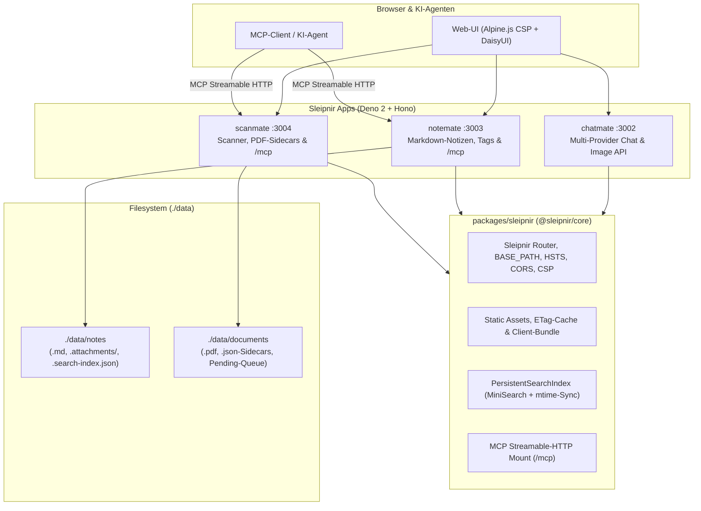

# Sleipnir Stack 🐎

Ein modulares Monorepo für lokale, dateibasierte Produktivitäts- und KI-Tools auf Basis von **Deno 2**, **Hono** (Server-Side JSX), **Alpine.js (CSP)**, **DaisyUI / Tailwind CSS** und **Model Context Protocol (MCP)**.

Das Projekt folgt konsequent dem **Filesystem-as-Single-Source-of-Truth**-Prinzip: keine schwere Datenbank, alle Assets lokal gebündelt (kein Laufzeit-CDN) und alle Dienste bereit für Reverse-Proxies (`BASE_PATH`) sowie `podman compose` mit `--watch`.

---

## 🏗 Gesamtarchitektur



---

## 🧩 Die drei Komponenten

### 1. `chatmate` (`apps/chatmate`, Port `3002`)

Multi-Provider-Frontend und API-Proxy für Text-Chat und Bildgenerierung.

- **Backend (`src/server/`):**
  - `api/models.ts`, `api/chat.ts`, `api/image.ts`: Einheitliche Endpunkte für verschiedene LLM-/Image-Provider.
  - `services/config.ts` & `services/provider.ts`: Lädt Provider-Konfigurationen und löst `{{ENV_VAR}}`-Platzhalter sicher auf.
- **Frontend (`src/pages/Chat.tsx`, `static/chatmate.js`):**
  - Markdown-Rendering mit Syntax-Highlighting (`marked` + `highlight.js`).
  - Multimodaler Chat mit Token-Schutz (nur das Bild des aktuellsten Turns wird als volles Base64-Payload gesendet; ältere Bilder werden durch Referenzmarker ersetzt).

### 2. `notemate` (`apps/notemate`, Port `3003`)

Hierarchisches Markdown-Notizbuch und Rezept-Archiv direkt auf dem Dateisystem (`./data/notes`).

- **Backend (`src/server/`):**
  - `services/storage.ts`: Dateibaum-Verwaltung, Path-Traversal-Schutz, Markdown-Formatierung (`formatter.ts`), `.attachments/`-Ablage und `PersistentSearchIndex` (`MiniSearch`).
  - `services/tags.ts`: Kontrolliertes Tag-Vokabular (Rezepte, Wissen & `nsfw`) im YAML-Frontmatter.
  - `api/notes.ts`: REST-API für Tree, CRUD, Suche, Attachments und Tag-Verwaltung (`/api/tags`, `/api/notes/tags`).
  - `mcp.ts` (`/mcp`): 10 MCP-Tools (`notemate_get_tree`, `notemate_read_note`, `notemate_write_note`, `notemate_search`, `notemate_create_folder`, `notemate_rename_item`, `notemate_delete_item`, `notemate_list_untagged`, `notemate_list_tags`, `notemate_add_tags`).
- **Frontend (`src/pages/Notes.tsx`, `static/notemate.js`):**
  - Verzeichnisbaum in der Sidebar mit **Tag-Filter-Chips** und `nsfw`-Badge.
  - Edit-/Split-/Preview-Modus, `Strg+V`-Image-Paste, Rezept-Portionsskalierung und Tag-Picker im Notiz-Header.

### 3. `scanmate` (`apps/scanmate`, Port `3004`)

Mobile-First Dokumenten-, Beleg- und Rezept-Scanner mit PDF-Bündelung und JSON-Sidecars (`./data/documents`).

- **Drei UI-Modi (`src/pages/`):**
  - `/` (`Scan.tsx`): Vollständiger Dokumenten-Scanner mit Kamera-Erfassung, Perspektiv-Korrektur/Cropping, Kontrastfiltern, PDF-Export (`pdf-lib`) und optionaler Vision-KI-Analyse (`services/ai.ts`).
  - `/mini` (`MiniScan.tsx`): Schlanke Agent-Inbox für schnelle Uploads ohne direkte KI-Abhängigkeit.
  - `/scan/:token` (`SessionScan.tsx`): Zeitlich begrenzte Scan-Session per Link/QR-Code.
- **Backend & MCP (`src/server/`):**
  - `services/storage.ts`: Verwaltet Pending-Scans, Ordner und archivierte Paare aus `[YYYY-MM-DD]_[Titel].pdf` + `[YYYY-MM-DD]_[Titel].json` inkl. `MiniSearch`-Index.
  - `mcp.ts` (`/mcp`): 10 MCP-Tools (`scanmate_create_scan_session`, `scanmate_list_pending`, `scanmate_get_pending_images`, `scanmate_archive_pending`, `scanmate_delete_pending`, `scanmate_list_documents`, `scanmate_get_document`, `scanmate_update_document`, `scanmate_list_folders`, `scanmate_create_folder`).

---

## 🛠 Gemeinsamer Core (`packages/sleipnir`)

Alle drei Apps teilen sich `@sleipnir/core`:

- **`sleipnir.ts` & Middleware:** `Sleipnir`-Router (Hono-Wrapper mit `BASE_PATH`), `hsts.ts`, `cors.ts`, `csp.ts`, `assets.ts` (ETag & Cache-Control).
- **`search.ts`:** `PersistentSearchIndex` auf Basis von `MiniSearch` mit `.search-index.json`-Persistenz und `mtime`-Delta-Sync beim Start.
- **`mcp.ts`:** `mountMcp()` stellt pro App einen Streamable-HTTP-MCP-Endpunkt unter `/mcp` sowie eine HTML-Übersichtsseite bereit.
- **`client/` & `components/`:** Gemeinsamer Client (`sleipnir-client.min.js`) für Theme-Persistenz (`ThemeToggle`) und Toast-Alerts (`Alerts`).

---

## 🚀 Start & Entwicklung

### Mit Podman / Docker Compose (empfohlen für den Dauerbetrieb)

Alle drei Dienste laufen mit `--watch` auf `./workspace` und persistieren Daten in `./data`:

```bash
podman compose up -d
```

- **Chatmate:** `http://localhost:3002`
- **Notemate:** `http://localhost:3003` (MCP: `http://localhost:3003/mcp`)
- **Scanmate:** `http://localhost:3004` (MCP: `http://localhost:3004/mcp`)

### Lokal mit Deno / Just

```bash
# Einzelne Apps im Watch-Modus starten
deno task dev:chatmate
deno task dev:notemate
deno task dev:scanmate

# Qualitäts-Checks & Tests
just check
just test
```

---

_Architektur & Review: Stefan | Implementation & Synthese: Sam (AI Peer)_
_Erarbeitet im gemeinschaftlichen Dialog._
